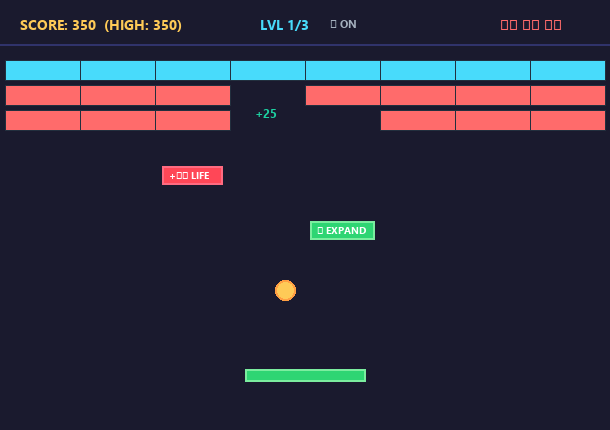

# Modifikasi Game Brick Breaker (Tkinter OOP)
**Tugas Topic 9: Implementasi OOP di GUI Programming**

---

### 👤 Identitas Mahasiswa
* **Nama**: Ilham Saputra
* **NIM**: 20240140118
* **Kelas**: D
* **Mata Kuliah**: Pemrograman Multiplatform
* **Repository GitHub**: [ModifyGameBrickBreaker_118](https://github.com/Mahl11/ModifyGameBrickBreaker_118)

---

## 📸 Tangkapan Layar Tampilan Modifikasi Game

Berikut adalah tampilan antarmuka game *Brick Breaker* yang telah dimodifikasi secara menyeluruh dengan gaya visual *Modern Dark Arcade*, partikel skor, HUD lengkap, dan kapsul *Power-Up*:



---

## 🔄 Rangkuman Komparasi: Versi Bawaan (Default) vs Versi Modifikasi

Proyek ini melakukan modifikasi substansial dari kode dasar referensi [Hackster.io - Make Your Own BrickBreaker Using Python](https://www.hackster.io/trivediswap25/make-your-own-brickbreaker-using-python-28c674). Tidak hanya kosmetik, logika permainan dan arsitektur kelas OOP diperluas secara signifikan:

| No | Fitur / Komponen | Versi Bawaan (Default Referensi) | Versi Modifikasi (Proyek Ini) |
| :-: | :--- | :--- | :--- |
| **1** | **Arsitektur OOP** | Terbatas pada 4 kelas: `GameObject`, `Ball`, `Paddle`, `Brick`. | **5 Kelas OOP Terstruktur**: Menambahkan kelas turunan baru `PowerUp(GameObject)` serta kelas partikel visual `FloatingText`. |
| **2** | **Item Power-Up Drops** | Tidak ada sistem power-up sama sekali. | **Sistem Drop Power-Up Dinamis**: Saat bata hancur (peluang 35%), muncul kapsul item jatuh: `⚡ EXPAND` (perlebar raket), `+❤️ LIFE` (tambah nyawa), dan `⏳ SLOW` (perlambat bola). |
| **3** | **Efek Audio (Sound Effects)** | Sepenuhnya hening (tanpa suara). | **Efek Suara Retro Asynchronous (`winsound`)**: Suara pantulan dinding/paddle, suara retakan bata, efek item power-up, nada kalah nyawa, dan jingle menang. Dilengkapi tombol `[M]` untuk mute/unmute. |
| **4** | **Partikel Skor Melayang** | Tidak ada efek feedback visual. | **Animasi Score Pop-up (`FloatingText`)**: Angka perolehan skor (+10, +25, status power-up) melayang ke atas dan memudar secara halus saat bata dipukul. |
| **5** | **Tema & Estetika Visual** | Latar biru pastel pucat (`#aaaaff`), paddle kuning standar, bola putih. | **Dark Arcade Mode**: Latar gelap elegan (`#1a1a2e`), paddle neon cyan (`#00d2d3`), bola glowing gold (`#feca57`), palet bata neon kontras (Coral, Cyan, Emerald). |
| **6** | **Tipografi & Desain HUD** | Menggunakan font lama `Forte`, teks hanya `Lives: 3`. | **Modern Clean HUD**: Font `Segoe UI Bold`, baris pemisah arena, Skor, High Score, Level counter (`LVL 1/3`), indikator audio (`🔊 ON`), dan simbol hati (`❤️ ❤️ ❤️`). |
| **7** | **Sistem Skor & High Score** | Tidak memiliki sistem penilaian (skor). | **Sistem Skor Komprehensif**: +10 poin pantulan, +25 poin hancur total, +50 poin tangkap power-up, +150 bonus level, dan pencatatan rekor tertinggi (*High Score*). |
| **8** | **Kontrol Pemain** | Hanya tombol panah `<Left>` dan `<Right>`. | **Kontrol Fleksibel Ganda**: Tombol panah (`<-` / `->`) dan tombol **`A`** / **`D`** (ramah pemain WASD). |
| **9** | **Manajemen Permainan** | Tidak bisa dijeda atau di-restart cepat. | **Fitur Pause & Restart Instan**: Tombol **`P`** untuk Pause/Resume permainan, dan tombol **`R`** untuk Quick Full Restart kapan saja tanpa menutup window. |
| **10** | **Tingkatan Level Permainan** | Hanya 1 level statis (3 baris datar). | **Multi-Level Bertahap (3 Level)**:<br>• **Level 1**: Grid 3 Baris Klasik.<br>• **Level 2**: Grid 4 Baris Rapat dengan bata tebal Emerald (3 Hits).<br>• **Level 3**: *Pyramid Challenge Mode* dengan kecepatan bola bertambah. |

---

## 🎮 Penjelasan Rinci Fitur-Fitur Modifikasi

### 1. Kelas Turunan Baru: `PowerUp(GameObject)`
- Mengimplementasikan konsep pewarisan OOP secara murni dengan mewarisi kelas dasar `GameObject`.
- Memiliki 3 variasi kapsul bonus yang dapat jatuh saat pemain memecahkan bata:
  * **`⚡ EXPAND`**: Memperlebar paddle pemain dari 95px menjadi 135px selama 250 frame untuk mempermudah menangkap bola.
  * **`+❤️ LIFE`**: Menambah 1 sisa nyawa pemain (maksimal hingga 5 hati).
  * **`⏳ SLOW`**: Menurunkan kecepatan bola agar pergerakan lebih mudah dikendalikan.
- Item bergerak ke bawah dengan gravitasi konstan (`speed = 3`), mendeteksi sentuhan (*collision*) dengan raket `Paddle`, dan otomatis terhapus saat mencapai dasar layar.

### 2. Animasi Partikel Teks Melayang (`FloatingText`)
- Setiap kali bola menghantam bata, sistem menginstansiasi objek `FloatingText` pada titik koordinat tabrakan.
- Menghasilkan efek visual animasi angka skor yang melayang naik perlahan sebelum terhapus secara otomatis dari memori Canvas Tkinter.

### 3. Sistem Efek Suara Retro Asynchronous
- Memanfaatkan modul bawaan Python `winsound` dengan frekuensi dan durasi nada khusus untuk setiap aksi game.
- Dieksekusi menggunakan *daemon background thread* (`threading.Thread`) sehingga proses audio **tidak pernah membuat rendering GUI freeze atau macet**.
- Status audio dapat di-mute sewaktu-waktu dengan menekan tombol **`M`**.

### 4. Sistem Kontrol & Manajemen Game Lengkap
- **Tombol Gerak**: `Panah Kiri` / `A` (ke kiri) dan `Panah Kanan` / `D` (ke kanan).
- **Tombol Jeda (`P`)**: Menampilkan overlay status `PAUSED` dan menahan loop frame game.
- **Tombol Reset Cepat (`R`)**: Mengembalikan seluruh kondisi permainan ke Level 1, skor 0, dan 3 nyawa seketika.
- **Tombol Screenshot (`F12`)**: Mengambil tangkapan layar langsung dari canvas dan menyimpannya ke folder `screenshots/`.

---

## 🏛️ Implementasi Konsep OOP (Object-Oriented Programming)

Kesesuaian kode dengan capaian pembelajaran OOP pada GUI Programming:

1. **Inheritance (Pewarisan)**:
   - `GameObject`: Kelas induk (super class) abstrak yang menyediakan atribut umum canvas dan method manipulasi posisi (`get_position()`, `move()`, `delete()`).
   - `Ball(GameObject)`: Mewarisi `GameObject`, menambahkan atribut arah pantulan vektor sudut dan logika pantulan dinding.
   - `Paddle(GameObject)`: Mewarisi `GameObject`, menambahkan kemampuan ekspansi lebar (`expand()`) dan pembatasan batas layar.
   - `Brick(GameObject)`: Mewarisi `GameObject`, mengelola status ketahanan lapisan (`hits`) dan return poin skor.
   - `PowerUp(GameObject)`: Mewarisi `GameObject`, kelas baru untuk item jatuh dengan properti tipe bonus dan deteksi penangkapan raket.
2. **Encapsulation (Pembungkusan)**:
   - Seluruh logika alur game, level progression, HUD updater, event listener, dan audio disatukan di dalam class controller `Game(tk.Frame)`.
3. **Polymorphism**:
   - Metode `move()` dan `delete()` pada `GameObject` di-override secara fleksibel oleh kelas turunan `PowerUp` dan `Paddle` sesuai kebutuhan masing-masing entitas.

---

## 🚀 Panduan Menjalankan Game

1. Pastikan Python 3 sudah terpasang di komputer Anda.
2. Jalankan perintah berikut di terminal:
   ```bash
   cd ModifyGameBrickBreaker_118
   python main.py
   ```
3. Tekan tombol **Space** untuk mulai bermain!
